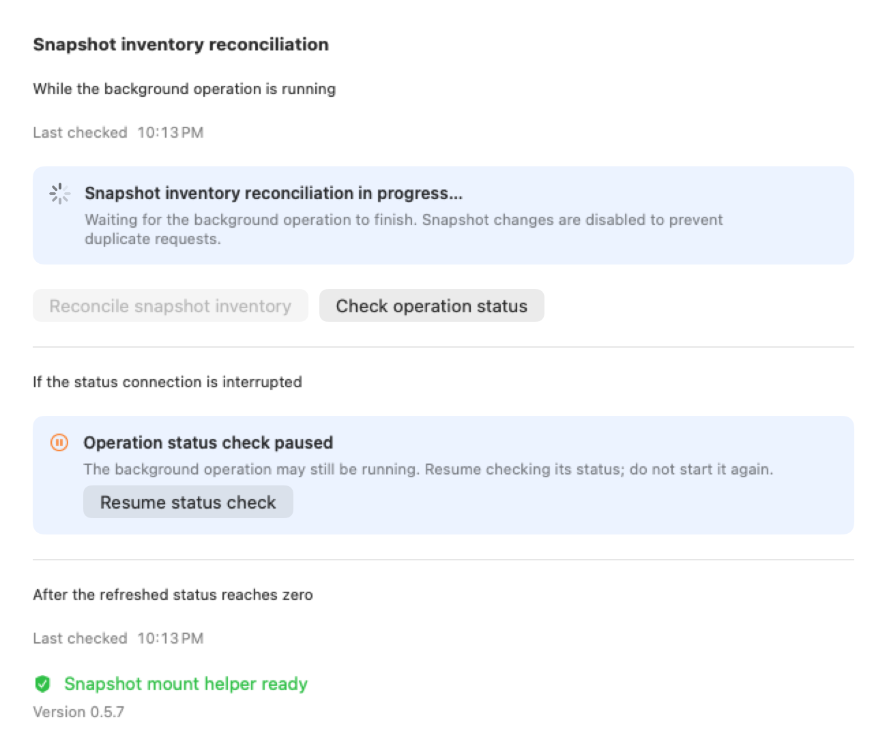
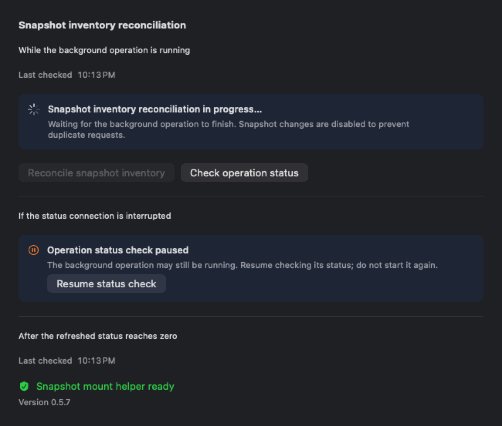
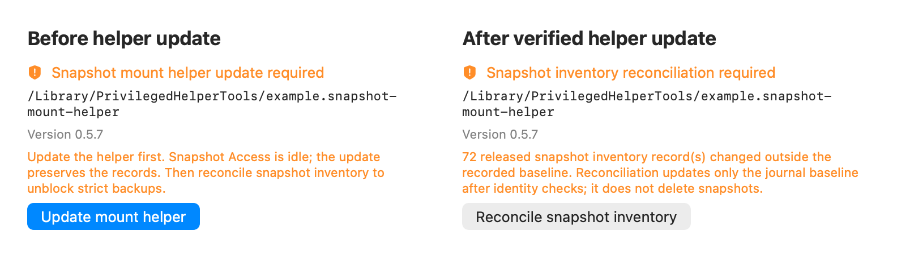
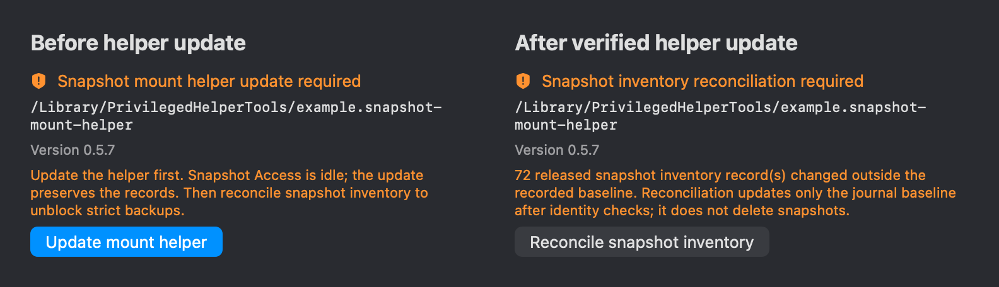

# APFS Snapshot Consistency

> Canonical topic for filesystem-timepoint backup reads on macOS APFS volumes.

## Context and Scope

Successful journal-bound cleanup MUST clear the recorded mount root and mount device when it
persists a released tombstone. Explicit legacy repair MUST include age-gated, owner-matching
released rows whose root, snapshot manifest, or baseline marker is incomplete. It MUST apply the
same managed-root, volume identity, and inventory checks before moving such a row back through
cleanup. Complete released tombstones MUST remain excluded from legacy migration; inventory
drift still requires the separate explicit reconciliation operation.

Historical `released` rows can retain the caller-owned
`<data>/snapshot-access/mounts/<uid>/<lease>` layout. Explicit repair MAY retire only their
journal identity when they are stale, owner-matching, have zero recorded mount device, and
every recorded snapshot UUID is absent from the UUID-bound volume. It MUST validate the exact
UID/lease suffix and no-follow ancestor metadata, reject matching snapshot sources and mounts
at/below the root in a complete kernel mount-table observation, and repeat volume, inventory
and mount observations. The guarded journal update MUST reject any non-released owner on the
same volume and retain unrecorded snapshots as baseline. This branch MUST NOT unmount, delete
snapshots or directories, or open source bytes. Unproven identity and concurrent changes leave
the original row intact and blocking.

TelevyBackup must read every file in a strict backup from one filesystem timepoint while live
files continue changing. This topic owns the user-session Snapshot Access app, its IPC contract,
the brokered core source, per-volume preferences, lifecycle cleanup, and macOS packaging. It does
not change application-level transaction semantics, Time Machine configuration, or remote storage
formats.

## Goals and Non-goals

### Goals

- Provide a separate, windowless Snapshot Access process embedded inside the single visible
  `TelevyBackup.app` at `Contents/Library/LoginItems/TelevyBackup Snapshot Access.app`, plus a
  narrowly-scoped root mount helper. The current validated strict-mode baseline grants FDA to each
  exact installed identity; the helper additionally needs root because macOS mount(2) privilege is
  not granted by FDA.
- Address sources by configured target ID and APFS Volume UUID, never by an arbitrary IPC path.
- Stream directory metadata and file bytes through an opaque lease without exposing the snapshot
  mount path to the daemon.
- Fail closed for strict volumes when FDA, snapshot creation, ownership, mounting, reading, or
  cleanup is unavailable.
- Keep CLI-only scheduled operation available through a per-user LaunchAgent with no administrator
  prompt after the one-time mount-helper installation.

### Non-goals

- No root backup daemon, root file reader, `fs_snapshot_*` entitlement, or staging copy. A minimal
  root LaunchDaemon is limited to mount, unmount, and journal-bound snapshot cleanup.
- No activity-directory fallback in strict mode and no changes to Time Machine policy.
- No defense against a malicious process running as the same macOS user.

## Requirements

### REQ-APFS-001: Access process boundary

The package MUST include exactly one top-level `TelevyBackup.app`. It MUST contain a separate
Snapshot Access app at `Contents/Library/LoginItems/TelevyBackup Snapshot Access.app` with bundle
identifier `com.ivan.televybackup.snapshot-access` and `LSUIElement=true`. It MUST run as the logged-in user,
reject root execution, keep its journal/socket/mount directories private to that user, and never
read Keychain data, encrypt backup data, or upload files.

### REQ-APFS-002: Versioned restricted IPC

The Access app MUST expose versioned `Status`, `ProbeVolume`, `AcquireLease`, `ScanPage`,
`OpenReadStream`, `ReadStream`, `CloseReadStream`, and `ReleaseLease` methods. Requests MUST use a
configured target ID or an opaque lease/stream ID. Peer UID, canonical source, APFS Volume UUID,
free-space threshold, nested mounts, and relative paths MUST be checked before access.

### REQ-APFS-003: Snapshot ownership and cleanup

`AcquireLease` MUST snapshot the target volume, uniquely confirm the snapshot created by that
  invocation, record its UUID/device manifest before serving data, and ask the root mount helper to
  mount it below a helper-managed per-user directory whose parent and lease target cannot be
  replaced by the requesting user. Release and crash recovery MUST unmount and delete only
  manifest-recorded snapshots; ambiguous ownership MUST fail the acquire before serving bytes, and
  failed cleanup MUST block the volume's next strict backup.

The mount helper MUST run as a root LaunchDaemon with FDA manually granted to its exact installed
identity, expose a separate peer-UID-checked Unix socket, and accept only `Status`, volume-scoped
`StatusVolume`, `Reserve`, `Renew`, `RecordCleanup`, `Mount`, `Release`, and journal-bound `Cleanup`. `Reserve` MUST
claim the requested volume before snapshot creation, bind the lease to the requested source path, and
prove that the peer UID can open that path before recording the pre-existing snapshot UUIDs;
`RecordCleanup` MUST invoke `tmutil localsnapshot` inside the root helper's serialized mutation section,
require exactly one new snapshot, and re-check the complete inventory before and after journaling it;
the Access process MUST renew an in-flight reservation while snapshot creation is running, and stale
recovery MUST use the last successful renewal time rather than creation time;
callers MUST NOT submit a deletion manifest. If recording fails, the reservation MUST remain blocking until a later retry succeeds. An age-gated recovery MAY transition an empty-manifest reservation to a retained `released` tombstone only after repeated inventory checks match its baseline; every later `Reserve` MUST audit those tombstones before serving bytes and move any changed tombstone back to `cleanup_pending`. An explicit legacy repair MAY migrate a stale row without a validated reservation baseline only after resolving the journaled volume UUID to the current APFS device, partitioning current inventory by snapshot UUID, and retaining every unrecorded snapshot as the new baseline; unresolved identity, duplicate UUID, malformed manifest, changed inventory, and unrecorded snapshots MUST remain blocked or retained and MUST NOT be deleted. `Release` MUST revalidate the journaled device/volume binding and require the current inventory to equal the recorded baseline plus the journaled manifest before deleting only that manifest; after deletion it MUST require the inventory to equal the original reservation baseline before clearing the recorded manifest and retaining the released tombstone. If deletion completed before a process crash, an exact recheck of that original baseline MUST allow the same journal-bound tombstone transition to converge idempotently. If the post-deletion inventory differs, the lease MUST remain `cleanup_pending` with the original baseline. A mounted journal row with a missing or zero recorded mount-device identity MUST remain blocked unless explicit legacy repair proves the exact APFS snapshot source with `statfs(2)`; ordinary cleanup MUST NOT infer that identity or unmount the path. `StatusVolume` MUST answer only
whether the requested volume UUID has a reserved, prepared, active, or cleanup-pending row and may expose only verified age-gated recovery candidates. A user-visible stale-record reconcile operation MAY call the authenticated-UID-scoped `Status` and the existing `Release` method only after Snapshot Access reports no active or pending lease; it MUST hold the daemon maintenance lock, require the current helper component and build identity, require the legacy aggregate to equal the complete additive classification partition and candidate count, stop on a live or pending-cleanup row, incomplete additive status, inconsistent counts, or identity failure, and use the same validation for the preflight and post-release status before returning success. A separate pending-cleanup retry MAY use the current or immediately previous cleanup-capable component when its v4 wire version, complete pending-only classification, and journal-bound candidate list are valid; it MUST still hold the same maintenance lock, verify Snapshot Access is idle, and use the existing `Release` validation for every exact lease. Neither operation may return success until the post-release aggregate is empty. Both operations MUST return sanitized counts. Settings MUST keep recovery disabled unless the same invariant is known, and a pending operation MUST eventually clear its busy state with a bounded timeout rather than treating a non-terminal operation as success. The global Status query is required so records for disabled or removed settings cannot remain an invisible blocker. `Cleanup` MUST
delete only the non-empty manifest already recorded in the matching prepared journal row. It MUST NOT read source files, configuration, Keychain
material, backup indexes, or network data. Its root-owned journal records lease, mount root,
volume/device identity, and the exact snapshot UUID manifest.

Source directory validation MUST pin a no-follow directory metadata descriptor, derive its backing device from kernel filesystem information, and query `diskutil info -plist` by that validated device rather than by a nested source pathname. The filesystem type, device identifier and volume UUID MUST match the lease, and descriptor/path identity MUST remain unchanged through authorization and reservation. A successful, structurally valid empty snapshot inventory is a valid baseline; command failures or malformed inventories MUST remain blocking. Command failures MUST retain a fixed stage, command category, exit status and diagnostic channel. Diagnostic summaries MUST be sanitized before a 512-character limit is applied; raw command arguments, source paths, UUIDs, plist bodies and secrets MUST NOT enter IPC errors or logs. Acquire failures retain the external `snapshot.acquire_failed` code.

Failed mounting MUST NOT make an owned snapshot permanently unreleasable merely because
`mount_device` was never captured. A `prepared` or `cleanup_pending` row with zero device identity
MAY use journal-bound cleanup only when its UID-derived managed root, snapshot name, exact manifests,
volume binding and complete kernel mount table prove that no matching snapshot source or root/descendant
is mounted. Root metadata checks remain no-follow and root-owned; the snapshot inventory must equal
the reservation baseline plus recorded UUIDs, or already equal the baseline. Other non-released owners,
unknown states, duplicate UUIDs, uncertain mounts and changed inventory remain blocked. This path never
unmounts a filesystem without a recorded device. Exact zero-device pending rows are retry candidates,
not proof of readiness. A released tombstone MAY account for extra UUIDs only when exactly one same-volume, same-UID
unfinished owner records that exact set and an identical baseline, with a valid managed root,
recognized state and validated journal manifests. The owning row MUST remain blocking. Successful
cleanup restores the original inventory; unrelated or ambiguous drift is never silently ignored.

### REQ-APFS-004: Brokered strict reads

The core MUST retain the configured logical source path in indexes and manifests while obtaining
all strict-mode entries and file bytes from the brokered source. Symlinks MUST NOT be followed,
nested mounted volumes MUST fail the scan, and a broker read error MUST fail the backup without
publishing a Backup Snapshot. The lease MUST be released once source bytes have been read into the
encrypted upload queue.

### REQ-APFS-005: Per-volume configuration and scheduling

`config.toml` MUST persist `snapshot_volumes.<APFS Volume UUID>.enabled`. Verification MUST
discover the current volume UUID and explain unsupported filesystems, insufficient space, missing
sources, or FDA failures. Targets on the same volume MUST serialize snapshot leases; a manual run
MUST supersede one pending scheduled batch, and cleanup-pending state MUST prevent a new strict
lease.

### REQ-APFS-006: User installation and observability

The main app MUST register the embedded agent with the platform launch service. The direct-launchctl
plist in an official ad-hoc release MUST use the fixed canonical `Program` path inside
`/Applications/TelevyBackup.app`; it MUST NOT accept a workspace or user-supplied helper path.
Official ad-hoc releases MUST use `launchctl bootstrap` on that plist from the installed product
bundle. `BundleProgram` MAY be used only by a separately signed `SMAppService.agent` build. The CLI
MUST expose only read-only `snapshot-access status` plus
internal migration operations; it MUST reject arbitrary external app paths and MUST NOT create a
new user LaunchAgent plist. Settings MUST show the exact embedded Access app and mount helper paths,
component versions, migration state, service reachability, active leases, pending cleanup, and a
link to System Settings. It MUST identify both paths as FDA requirements for strict mode, report
only observable FDA evidence, and never present service reachability as proof of a helper TCC grant.
The first layout migration is user-level; mount helper install, update, and uninstall remain
explicit administrator-authorized transactions and are the only privileged setup operation.
Mount-helper Status MAY add optional `component_version`, `build_commit`, and cleanup-candidate fields without changing the protocol or journal schema. The existing `helper_version` remains the v4 wire-compatibility version so the approved Snapshot Access artifact can continue to communicate with a patch-level root-helper update. Legacy Status without either additive field remains readable, but installation readiness MUST require the current component version, the running build commit to equal the installing candidate, and the installed binary SHA-256 to equal the candidate binary. A legacy status may authorize replacement directly when its explicit `active_mounts` aggregate is zero. When that aggregate is positive but additive classification is unavailable, the installer MAY replace the legacy helper only after Snapshot Access confirms zero active leases and pending cleanup; the replacement itself MUST serve no lease and the candidate helper MUST classify the inherited journal before readiness is acknowledged. A stale known helper MAY also use this guarded replacement path when the complete additive partition is present, every row is classified as `unknown_blocking`, all other counts and candidate lists are zero, and the authenticated build identity is different from the installing candidate; this is an upgrade escape hatch, not a cleanup or readiness result. A positive legacy aggregate remains blocking for lease acquisition and cleanup, and MUST NOT be treated as proof that a live mount is absent. A matching compatibility component version alone MUST NOT acknowledge installation success. The approved Snapshot Access artifact remains unchanged.

When Status reports only `cleanup_pending` rows and no live, stale-recoverable, or unknown rows, the CLI and daemon MAY expose an explicit cleanup-retry operation. That operation MUST first verify Snapshot Access is idle, hold the maintenance/mutation lock, validate the additive candidate list against the aggregate, and invoke the existing journal-bound `Release` for each exact lease. Inventory, UID, device, manifest, or lease validation failures MUST leave the row pending and return `snapshot_mount_helper.pending_cleanup`; status refresh MUST remain read-only. The UI MUST expose the operation only for this verified pending-only classification. A previous cleanup-capable helper that reports the pending-only aggregate but omits lease candidates MAY expose only a guarded update action; a current-component helper with a different or missing build identity MAY also expose that guarded update action when the complete pending-only candidate partition is verified and Snapshot Access is idle. A current-component helper from a stale build that reports the live, pending, recoverable, and unknown partitions but omits only the newer inventory-drift field MAY likewise expose the guarded update action after Snapshot Access proves idle; this replacement preserves the journal, serves no lease, and requires the candidate to classify the inherited journal before readiness. After any guarded replacement, the candidate MUST classify the inherited journal before the cleanup-retry action becomes available.
Mount-helper Status MAY additionally expose optional `pending_cleanup`, `live_mounts`, `recoverable_stale_mounts`, and `unknown_blocking_mounts` counts. They are additive and absent fields MUST remain unknown to callers rather than becoming a false zero. When present, `pending_cleanup` describes rows awaiting inventory reconciliation and remains a distinct blocking state; `live_mounts` describes recent non-cleanup rows; `recoverable_stale_mounts` contains only verified age-gated `reserved`, `prepared`, or `active` rows; and `unknown_blocking_mounts` covers every other unverified row. Pending-cleanup rows MUST NOT enter the recovery candidate list. The legacy `active_mounts` aggregate remains blocking and MUST NOT be interpreted as proof that a live mount exists. Settings MAY expose an explicit recover-stale-records action only when the recoverable count is known and non-zero; status refresh MUST remain read-only. Known active or mixed status fixtures MUST include `pending_cleanup` (zero when none are pending), while omitted fields continue to exercise the unknown-blocker path. When the helper is unreachable, Settings MUST retain an administrator-authorized install action rather than disabling all helper actions; the install transaction remains fail-closed.

Status MUST also distinguish a released tombstone whose validated device/volume identity is intact but whose current snapshot inventory differs from its recorded baseline. Such `inventory_drift` rows MUST remain blocking and MUST NOT be treated as live mounts, pending cleanup, or unknown rows. An explicit inventory-reconcile operation MAY invoke the existing journal-bound `Release` for each exact drift lease only after Snapshot Access is idle, no other helper category is present, the authenticated UID and current helper identity are verified, and the helper rechecks the baseline, current inventory, device binding, and post-update inventory while holding its mutation lock. Reconciliation MAY update only the released row's baseline; it MUST NOT delete snapshots or open source files. Any identity, inventory, lease, or concurrency failure MUST leave the row blocking. The additive `inventory_drift_mounts` and `inventory_drift_leases` fields are optional for wire compatibility; omission remains unknown and blocks the action.
A known compatible helper with a stale build MAY enter the existing administrator-authorized replacement transaction when its complete classification is inventory-drift-only, every drift candidate is an exact distinct released lease reported as `released_inventory_drift`, and Snapshot Access proves idle. The transaction MUST preserve the journal, repeat classification and idle checks under its existing locks before service replacement, and verify the installed candidate identity and hash afterward. It MUST NOT reconcile or delete records during replacement. Hosted upgrade evidence MUST use an approved published Access artifact that matches the trusted current component contract. Mixed, incomplete, malformed, duplicate, or live candidates remain blocked. Settings MUST offer Update first in this state, explain that inventory reconciliation follows verified replacement, and avoid a simultaneous disabled reconcile action or generic live-backup waiting message. A matching helper remains subject to the explicit inventory-reconcile checks above.
The ordinary Snapshot Access `Release` request MUST NOT perform that re-baselining: if its journal row is already released, it MUST return a distinct reconciliation-required result without changing the tombstone. Only the explicit maintenance operation may set the additive reconciliation flag. Unknown journal states and malformed released tombstones MUST remain untouched by startup recovery and MUST fence new reservations until an explicit repair or reconciliation clears them. Status evaluation MUST serialize rather than converting normal concurrent status requests into a false helper-unavailable result.
Settings MUST distinguish a background maintenance operation from observation of that operation. An accepted operation MUST remain active while the daemon reports `pending` or `running`; a fixed UI poll count MUST NOT turn it into a failed operation. A status-query failure MUST preserve the accepted operation identity and expose an explicit resume-status action without submitting a second mutation. Snapshot mutation controls remain disabled while an accepted operation is unresolved; read-only status checks and the privacy-settings link remain available. Leaving the pane MUST suspend observation rather than cancel the daemon operation.
Settings snapshot reads MUST be latest-request-wins: a delayed earlier response MUST NOT replace a newer result or a result from after a maintenance transition. While the Snapshots pane is visible, it MUST periodically query read-only status, expose the last successful check time, and mark retained values stale when refresh fails. A current verified zero-blocker status MUST remove the old drift count and reconciliation action. Query success MUST NOT erase a separately retained installation or terminal-operation error. These UI changes MUST NOT alter helper authorization, journal writes, component versions or protocol methods.
After successful service bootstrap, installation MUST retry status probes throughout a 20-second monotonic startup window instead of exhausting a fixed number of immediate connection failures. Poll intervals MUST be at most 250ms and MUST NOT extend beyond the remaining startup window; an in-flight status request retains its bounded I/O timeout, and a response that arrives after the startup deadline MUST NOT acknowledge success. Deadline failure MUST retain the final diagnostic and the startup-window context. Connection refusal, an old process, or missing build identity MUST never bypass the existing candidate identity and installed-file hash checks.
The daemon's `snapshot.status` MUST query the root helper directly for build identity, independently of the approved Access artifact's legacy status fields. It MUST distinguish reachability from readiness and report the running and expected source commits. Missing, malformed, or different running identity MUST NOT report readiness. Settings MUST additionally match that identity to the current app bundle, show an update-required state and an administrator-authorized update action for a reachable stale helper, and retain the install action for an unavailable helper. Status refresh MUST NOT install or restart the helper. Final installation confirmation MUST use the same app-bound readiness predicate; a reachable old helper or older daemon response without build evidence cannot acknowledge success.
Migration commit and rollback MUST require the transaction id and a short-lived owner token from
the same prepare operation; missing or mismatched transaction credentials MUST fail closed.

An app update MUST verify the running Access code against the installed embedded artifact; equal paths and component versions alone do not prove that a surviving process is current. Running-code validation MUST precede resolving its on-disk bundle path, since static signing information alone describes a replacement file. Direct registration MUST serialize its inspect, preparation, recheck, and start sequence across application processes with a per-user private lock, inspect the loaded service before bootstrap, retain a healthy current process, and restart an outdated process only after stopping the producer daemon and confirming zero active leases and pending cleanup. Unknown lease state, a foreign executable, or a changed service PID MUST fail without killing the service. The mount-helper install button MUST complete this user-level Access registration check before its final communication check. These lifecycle repairs reuse the approved Access artifact and do not change its FDA identity or IPC protocol.

## Compatibility

The Access app is started by the main app's per-user embedded launch service and can be used
without the GUI after registration. The official ad-hoc path uses `launchctl bootstrap`; a signed
build may use `SMAppService.agent`. The v0.9.8 helper remains readable for the one-time lease
probe, while only the current component may be committed or used for strict reads; strict lease
acquisition MUST reject a legacy helper before `Reserve`. RC1 establishes
the embedded helper identity; ordinary future product-version RC1 builds reuse the approved
artifact named by the component lock, and RC2/stable reuse that version's exact Universal artifact,
so ordinary main-app updates do not request FDA again. A real Access helper code or FDA behavior
change creates a new component version and requires explicit migration and manual FDA review.
Production migration MUST run from `/Applications/TelevyBackup.app`; direct DMG launches MUST fail
closed instead of registering a mounted helper. Existing settings without `snapshot_volumes` remain
valid and default to live mode until a volume is verified and enabled.

## Verification

### VER-APFS-001: Contract and package

Covers: REQ-APFS-001, REQ-APFS-002.
Rust/Swift tests, the spec contract checker, package asset verification, and an isolated
unique-label `launchctl bootstrap` fixture prove that target IDs, volume UUID preferences,
additive status fields, the separate app bundle, the minimal mount-helper artifact, and
user/system service paths are present without a privileged backup reader.

A dispatch-only GitHub-hosted macOS upgrade regression MUST compile the candidate registration code before mutating fixture services, then keep the published rc.114 Access process alive while replacing its on-disk bundle and installing the rc.120 mount helper. Candidate registration code must reject the old running identity, refresh the idle owned LaunchAgent, restore protocol communication, and retain the healthy replacement on a second registration. Fixtures use empty configuration and require no APFS snapshots, protected user files, or TCC changes. Synthetic tests additionally prove that active, unknown, foreign, and changed-process states cannot be restarted. Synthetic tests MUST also prove a concurrent application process cannot inspect or restart the service while another registration holds the lock. Initial service checks MUST require confirmed missing-service responses and abort on permission, I/O, or other inspection failures before fixture setup. Initial and final fixture path-absence checks MUST NOT follow symlinks; a pre-existing dangling link is existing state and MUST block setup. Cleanup MUST verify both fixture services have stopped before deleting any created executable, plist, socket, journal, or temporary source tree; an unverifiable shutdown MUST preserve those targets and fail the fixture. Success requires both fixture services and their created privileged state to be absent after cleanup.

### VER-APFS-002: Access lifecycle and boundary

Installer regression tests MUST prove that a helper which refuses connections beyond the former subsecond probe window can become ready without a manual refresh, while permanent refusal and stale or missing identity still fail within the bounded startup policy. A GitHub-hosted macOS fixture MUST delay initialization of the real root helper with a disposable journal lock and verify the production privileged installer returns success after the helper becomes ready; it MUST NOT add a production delay or command override. The published-artifact phase MAY expose only the legacy wire compatibility field, so the fixture MUST defer additive component-identity assertions until the candidate replacement phase.

The default-off `snapshot_source_validation` dispatch MUST run on GitHub-hosted macOS with a disposable APFS image and volume ownership enabled. It MUST reproduce the baseline nested-directory command failure through production Reserve, then prove candidate Reserve records the exact non-root UID, source, device, UUID and valid empty baseline without creating snapshots. Negative cases MUST reject wrong identity, symlinks, missing or inaccessible directories and cross-UID requests without a serviceable lease; a pinned source descriptor MUST also reject actual loss of its disposable image mount. Fixture services MUST be confirmed stopped before their owned state is removed. Candidate installation MUST prove IPC build identity and installed file hash while preserving the approved Access bundle byte-for-byte; this validation does not establish FDA readiness or full backup completion. Existing workflow steps invoking the recovery fixture MUST use an explicit multiline command block so each required option reaches the script as a separate argument.

Covers: REQ-APFS-003.
Snapshot Access and mount-helper unit tests prove fixed command usage, peer UID enforcement, arbitrary-path
rejection, private journal/mount ownership, unique snapshot ownership, journal-bound cleanup, and
foreign journal recovery isolation.

### VER-APFS-003: Brokered data integrity

Covers: REQ-APFS-004.
Core and daemon tests prove metadata and bytes come from the broker, post-snapshot live mutations
are absent, logical source identity is preserved, symlinks are not followed, and broker read
failures publish no strict Backup Snapshot.

### VER-APFS-004: macOS integration

Covers: REQ-APFS-005, REQ-APFS-006.
On a controlled APFS fixture, the workspace-built non-root Access app creates the snapshot and the
root mount helper performs only the mount operation; the daemon receives no mount path, configured
source roots can be sampled, and cleanup uses only the recorded manifest. FDA changes are performed
manually by the owner and are not automated by tests.

### VER-APFS-005: RC migration and authorization continuity

On the controlled macOS 15 fixture, migrate the v0.9.8 external registration to RC1, grant FDA
once to the embedded Snapshot Access app in System Settings, and prove a strict backup can read a
protected source. Replace `/Applications/TelevyBackup.app` with RC2 from the same RC1 Universal
helper artifact, compare the helper SHA-256/CDHash/designated requirement and repeat the strict
backup without granting FDA again. Record that the root mount helper remains at its installed path
and version. The result is a manual release artifact; tests MUST NOT modify TCC state.

## Related ADRs

- [0008-apfs-snapshot-access-app](../../adr/0008-apfs-snapshot-access-app.md)
- [0009-apfs-snapshot-mount-helper](../../adr/0009-apfs-snapshot-mount-helper.md)
- [0010-identity-stable-single-product-release](../../adr/0010-identity-stable-single-product-release.md)
- [0016-direct-launchctl-snapshot-access-registration](../../adr/0016-direct-launchctl-snapshot-access-registration.md)

## Visual Evidence

Maintenance observation and refreshed zero-blocker status (synthetic production components):

Stale-build inventory reconciliation sequence (synthetic light/dark previews):

The Settings Snapshots screen is captured from the deterministic `SettingsUIDemo` source:

- [Snapshot Access ready](assets/snapshot-access-ready.png)
- [Snapshot Access requires FDA](assets/snapshot-access-fda-required.png)

Administrator installation failures remain visible after the status refresh. These production notices are rendered in GitHub Actions from synthetic installation and status callbacks:

- [Mount helper installation failure, light](assets/mount-helper-install-error-light.png)
- [Mount helper installation failure, dark](assets/mount-helper-install-error-dark.png)

Build readiness and its explicit administrator action are rendered from the production status component with synthetic identities. A reachable stale helper retains Update; only the current app-bound build is ready; an unavailable helper retains Install:

- [Mount helper update states, light](assets/mount-helper-update-light.png)
- [Mount helper update states, dark](assets/mount-helper-update-dark.png)

### Backup preparation and mounted-root cleanup

- Snapshot acquisition uses a separate bounded long-operation deadline; status remains short-lived. A valid acquire response arriving after the status deadline must remain receivable.
- Before acquiring a strict lease, the daemon holds its snapshot maintenance lock and may invoke the existing inventory-only reconciliation for verified released tombstones. Snapshot Access must be idle, all classification fields and counts must agree, and live, pending, stale, unknown or foreign-owned records continue to reject. Refresh remains read-only. Inventory reconciliation never deletes snapshots or opens source bytes.
- A mounted snapshot root inherits source filesystem ownership and permissions. Cleanup validates protected managed ancestors and the recorded mount device rather than requiring the mounted filesystem root to have empty-mountpoint permissions. An unmounted managed directory remains root-owned, non-writable by other users, and no-follow.
- Released-row audits validate the requested device/volume binding once per serialized audit and compare each row against that exact binding; they must not spawn a system query per historical row.

### Snapshot Access recovery implementation identity

Snapshot Access component 0.2.1 includes persisted cleanup retries and the current lease/path safety implementation. A reused older component must not be accepted as proof that current source behavior is installed. A component upgrade builds a fresh candidate artifact, verifies its metadata, binary identity and source commit, and requires a fresh FDA grant when macOS invalidates the prior code requirement. Subsequent product releases may reuse that verified artifact byte-for-byte under the existing component policy. Protocol 2 remains unchanged; 0.2.0 requires an explicit component upgrade.

Snapshot Access releases a newly acquired lease when its response cannot be delivered to the caller; cleanup failures remain persisted for retry. The regression uses a disconnected Unix socket and verifies cleanup is scheduled only for the undelivered lease.

Snapshot creation may coincide with Time Machine pruning older snapshots. RecordCleanup binds its sole new UUID to the exact name from the fixed tmutil creation receipt, keeps all currently existing non-owned snapshots as the retained baseline, and atomically aligns already-clean same-owner terminal baselines. Missing historical snapshots never become deletion targets. Ambiguous creation receipts or additional new UUIDs remain blocked. Explicit repair may audit inactive pending records together with released drift using the same age- and identity-gated root method; only a released-only residual partition may subsequently be reconciled. Live mounts and unknown or rejected identities remain blocked.
